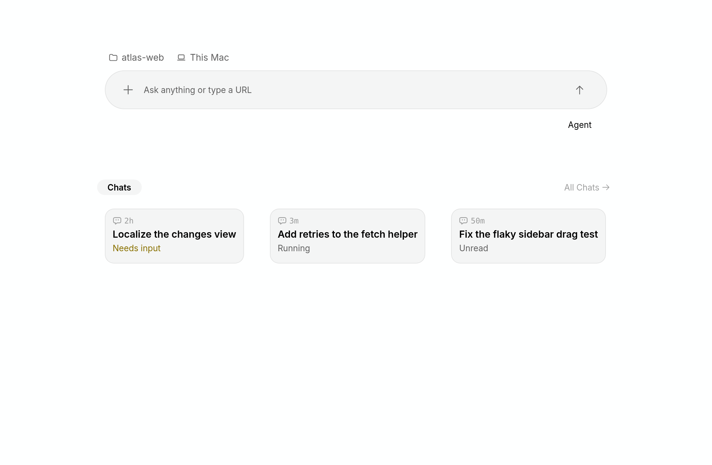

# Cards New Tab

[](https://cmux.com/setups/manaflow-ai/cmux-newtab-cards-look)



cmux's Cards New Tab page, as a look you install: one rounded field, the folder and the agent under
it, then "Chats" and your three most recent chats as cards, each with its agent, its age, its title
and its last reply (or what it waits on).

It used to ship inside cmux as a New Tab template. It is now built only on the public
customization API, so you can read and change every part of it:

| File | What it does |
| --- | --- |
| `cmux-setup.json` | Sets `tabs.newTabApp` to this look's view, so it draws the New Tab page |
| `customize/` | A `cmux.newtab/1` view: the field, the chips and the chat cards (`main.js`) |
| `shots/` | How the screenshots are drawn: `main.js` in cmux's own app runtime, through cmux's web New Tab page |
| `SHOTS.md` | Before (the template cmux shipped) and after (this look), side by side |

```sh
cmux setup install github.com/manaflow-ai/cmux-newtab-cards-look
cmux setup remove manaflow-ai/newtab-cards-look
```

Reading your chats is granted at install. Starting a chat from the field and opening a card need
Run actions and Change workspaces, which you turn on in Settings > Apps > My views.

While it is installed, its `customize/` view stands in for your own view, if you have one;
`cmux setup remove` puts yours back and cmux draws its own New Tab page again.

## What the public API does not do yet

The look follows cmux's own page as far as the API reaches today. What is still missing is
tracked in the cmux repository and lands there, not here:

- cmux's own composer as a view node (model and effort chips, attachments, dictation, the
  suggestions under the field). Until then the field is a plain text field that starts a chat with
  `newTab.submit`, in a new tab.
- Recent chats read and ordered by cmux itself (`agent_chat.list` with `limit`), with each chat's
  last reply. Until then, on an older cmux, the look orders the chats itself.
- An agent's own mark for a card, and the card's raised surface and shadow.
